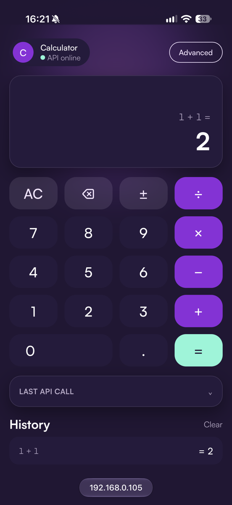
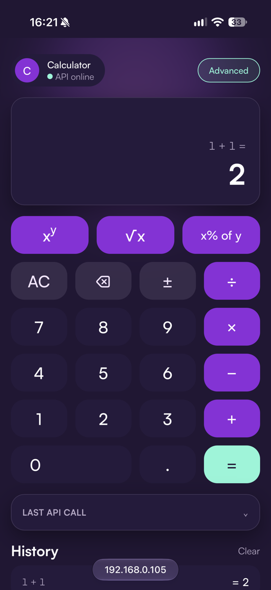
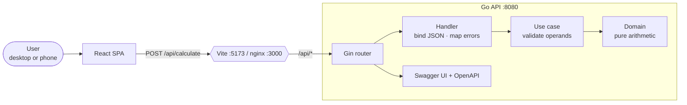
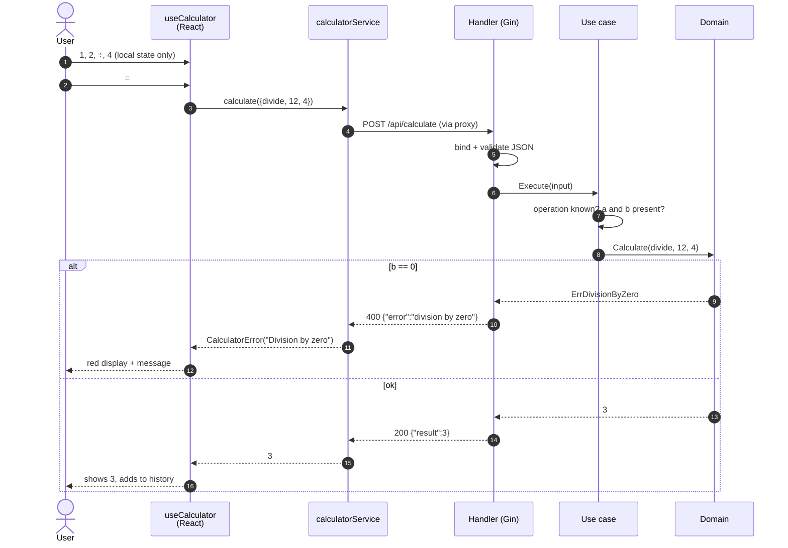

# Full-Stack Calculator

A calculator with a **React + TypeScript + Vite** frontend and a **Go + Gin** REST API. The frontend does no arithmetic: every calculation is sent to the backend.

- **Operations:** add, subtract, multiply, divide, plus optional power, square root and percentage
- **Validation and errors:** malformed JSON, wrong types, missing operands, unsupported operations, division by zero, square root of a negative number, overflow
- **Rate limiting:** per client IP (default 20 requests/minute), returning `429` with `Retry-After`, and resistant to spoofed `X-Forwarded-For` headers
- **UI:** keypad with physical keyboard support, validation feedback, an API status indicator, a "Last API call" inspector and calculation history. Mobile-first layout built on the Sezzle-inspired design system in [`design-system/`](design-system/DESIGN.md)
- **Tests:** Go unit and HTTP integration tests (100% statement coverage of `internal/`), Vitest unit and React Testing Library + MSW integration tests, and **Playwright E2E** tests of the real React app against the real Go API, on desktop and mobile
- **Docker:** multi-stage images and Docker Compose, with nginx proxying `/api`
- **CI:** GitHub Actions for formatting, lint, type check, tests with coverage, builds and the Docker build
- **API docs:** an OpenAPI 3 spec with interactive **Swagger UI** at [`/api/docs`](#api-documentation-swagger--openapi), plus Mermaid diagrams in [`docs/ARCHITECTURE.md`](docs/ARCHITECTURE.md)

## Screenshots

Running on a physical iPhone over the local network (`http://<mac-ip>:5173`). The calculation is done by the Go API.

<table>
  <tr>
    <td align="center"></td>
    <td align="center"></td>
  </tr>
  <tr>
    <td align="center"><b>Basic mode</b>: result, expression and history</td>
    <td align="center"><b>Advanced mode</b>: xʸ, √x and x% of y</td>
  </tr>
</table>

## Architecture at a glance

The browser only calls its own origin. A proxy (Vite in development, nginx in Docker) forwards `/api/*` to the Go service, which processes the request as **Router → Handler → Use case → Domain**.



What happens when the user calculates `12 ÷ 4`:



More diagrams are in [`docs/ARCHITECTURE.md`](docs/ARCHITECTURE.md): the full backend decision flow, error mapping, package dependencies, frontend layers, the keypad state machine, chained operations and deployment topologies.

## Repository layout

```text
backend/                      Go + Gin API
  cmd/api/main.go             entrypoint (config from env, graceful shutdown)
  internal/config/            env config: PORT, RATE_LIMIT_*, TRUSTED_PROXIES
  internal/router/            route + middleware registration
  internal/handler/           HTTP ↔ use case, error → status mapping
  internal/usecase/           input validation, orchestration (no Gin)
  internal/domain/            pure arithmetic + domain errors
  internal/dto/               JSON request/response contract
  internal/middleware/        per-client-IP rate limiting (token bucket)
  internal/docs/              openapi.yaml (embedded) + Swagger UI handler
  tests/                      httptest integration tests (full stack)
docs/ARCHITECTURE.md          Mermaid diagrams (flows, layers, state machine)
frontend/                     React + TypeScript + Vite + Tailwind v4
  src/features/calculator/
    CalculatorPage.tsx        page composition + keyboard support
    components/               Display, Keypad, ApiCallInspector, CalculationHistory
    hooks/useCalculator.ts    ViewModel: keypad state, loading, errors, history
    services/                 calculatorService: API calls + error mapping
    types/                    API contract types + operation metadata
    utils/entry.ts            pure input-editing / number-formatting helpers
  src/lib/api.ts              fetch wrapper, base URL from env
  src/tests/                  Vitest setup + MSW mock server
  e2e/                        Playwright E2E tests (real frontend + real API)
  playwright.config.ts        starts the Go API + Vite, desktop & mobile projects
design-system/                tokens.css (Tailwind v4 @theme), DESIGN.md, sketch
compose.yaml                  frontend (nginx) + backend
```

## Prerequisites

| Tool | Version used |
| --- | --- |
| Go | 1.27 |
| Node.js / npm | 24+ / 11+ (developed on Node 25) |
| Docker (optional) | Docker Compose v2 |

## Running locally

**1. Backend** (listens on `:8080`, override with `PORT`)

```bash
cd backend
go run ./cmd/api
```

**2. Frontend** (in another terminal)

```bash
cd frontend
npm install
npm run dev        # http://localhost:5173
```

The Vite dev server proxies `/api/*` to `http://localhost:8080`, so the browser only talks to one origin and the backend needs no CORS configuration. Set `VITE_API_PROXY_TARGET` to point the proxy elsewhere, or `VITE_API_BASE_URL` to call an absolute URL (see [`.env.example`](.env.example)).

## Running with Docker

```bash
docker compose up --build
```

- App: http://localhost:3000 (set `FRONTEND_PORT` to change it)
- API: http://localhost:8080

The frontend image is a static build served by nginx, which also proxies `/api/` to the `backend` service. The browser cannot resolve Docker service hostnames, so the browser always calls its own origin and nginx forwards the request inside the Docker network. The frontend image is built from the repository root because it imports `design-system/tokens.css`.

## Deploying (Oracle Cloud Always Free)

The same Compose stack runs on a single free Oracle Cloud VM. A production override adds **Caddy** for automatic HTTPS and exposes only ports 80/443:

```bash
# on an Ubuntu VM (after opening 80/443 in the VCN Security List)
git clone <repo-url> ~/calculator
~/calculator/deploy/oracle/setup.sh <repo-url> [your-domain]
```

The step-by-step guide is in [`docs/DEPLOYMENT.md`](docs/DEPLOYMENT.md). It covers account and VM creation, Oracle's two firewalls, a free DuckDNS domain for HTTPS, operations and troubleshooting.

## Tests and coverage

**Backend**

```bash
cd backend
go test ./...                                                     # unit + integration
go test -coverpkg=./internal/... -coverprofile=coverage.out ./... # coverage across packages
go tool cover -func=coverage.out                                  # summary (100.0%)
go tool cover -html=coverage.out -o coverage.html                 # HTML report
```

- `internal/domain`: table-driven tests of every operation and every error (overflow, NaN, unknown operation, and so on)
- `internal/usecase`: operand presence (`nil` vs `0`), unary vs binary handling, and error propagation
- `internal/handler`: handler tests against a fake use case, covering JSON decoding errors, error-to-status mapping and a hidden 500
- `internal/docs`: a contract test that fails if the `Operation` enum in `openapi.yaml` drifts from `domain.Operations`
- `tests/`: integration tests through the real Gin router with `httptest`, covering every operation, every error, the JSON content type, the docs routes, 404 and 405

**Frontend**

```bash
cd frontend
npm test               # Vitest, run once
npm run test:coverage  # text summary + HTML report in frontend/coverage/index.html
npm run lint && npm run typecheck
```

- `utils/entry.test.ts`: pure input editing and number formatting
- `services/calculatorService.test.ts`: request body and error mapping (4xx message, 5xx hidden, network failure) against MSW
- `hooks/useCalculator.test.ts`: the keypad state machine (chaining, switching operator, unary ops, validation, error recovery, history cap)
- `CalculatorPage.test.tsx`: integration from View to hook to service to mocked HTTP (keypad, keyboard, error display, API status, advanced mode)

**End-to-end (Playwright)**

```bash
cd frontend
npx playwright install chromium   # first time only
npm run test:e2e                  # headless, desktop + mobile (Pixel 7)
npm run test:e2e:ui               # interactive UI mode
```

Playwright starts its **own** Go API (`go run`, port 18080) and Vite app (port 4173) and shuts them down afterwards. You don't need to start anything first, and a dev server or Docker stack that is already running is never reused by mistake. Go must be installed.

Nothing is mocked: the real browser goes through the real React app and the Vite proxy to the real Go API. That catches things MSW cannot, such as contract drift between the TypeScript types and the Go DTOs. The tests in `e2e/calculator.spec.ts` cover:

| Test | What it proves |
| --- | --- |
| calculates with the keypad and records the call | happy path; the inspector shows the real request and response (`200`, `"result": 36`) |
| chains operations from the keyboard | `2+3*4⏎` = `20` when typed at full speed |
| shows the division by zero error and recovers | the backend's `400` error is shown in red; fixing the divisor and retrying works |
| validates a missing second number without calling the API | client-side validation sends **no** request |
| runs advanced operations and backend validation | √, percentage, and the backend's "square root of a negative number" error |

Each test runs in a desktop project and a mobile project (Pixel 7 viewport with touch), 10 runs in total. On failure, the trace, screenshot and HTML report are kept in `frontend/test-results` and `frontend/playwright-report`, and CI uploads them as an artifact.

> **A bug found by E2E.** The keyboard test first failed with `5` instead of `20`. The UI was **dropping** keystrokes typed while the chained `2 + 3` request was in flight. MSW answers instantly, so the mocked tests had never hit this. The hook now queues input and applies it in order (see the design decisions below). A unit regression test with a deliberately slow mocked response checks this; it fails on the old code and passes on the fix.

Current results: frontend 45 unit and integration tests (96% statements, 98% lines) and 10 E2E runs, all passing. Backend 100% statements of `internal/`.

## API

### API documentation (Swagger / OpenAPI)

The API is described by a hand-written OpenAPI 3.0 spec, [`backend/internal/docs/openapi.yaml`](backend/internal/docs/openapi.yaml). It is embedded in the Go binary with `go:embed`, so the docs always ship with the code they describe.

| URL | What |
| --- | --- |
| http://localhost:8080/api/docs | **Swagger UI**: browse the endpoints, with request examples for every operation and every error, and use **"Try it out"** to call the API |
| http://localhost:8080/api/openapi.yaml | raw spec, which you can import into Postman, Insomnia or a client generator |

They are also reachable through the frontend's proxy: `localhost:5173/api/docs` in dev and `localhost:3000/api/docs` in Docker.

- **Hand-written, not generated:** writing the spec by hand avoids annotation-driven code generation (swaggo) and its extra dependencies for a two-endpoint API.
- **Drift is caught by a test:** `internal/docs/docs_test.go` fails if the spec's `Operation` enum and `domain.Operations` disagree, or if a route is undocumented.
- **Lint result:** `npx @redocly/cli lint backend/internal/docs/openapi.yaml` passes with one warning (no license field).
- **Swagger UI is loaded from a pinned CDN version,** so the page needs internet access. The spec itself does not.

### `POST /api/calculate`

| Field | Type | Notes |
| --- | --- | --- |
| `operation` | string | `add`, `subtract`, `multiply`, `divide`, `power`, `sqrt`, `percentage` |
| `a` | number | required |
| `b` | number | required for every operation except `sqrt` (where it is ignored) |

- `percentage` means **"a percent of b"**: `(a / 100) * b`. For example, `15` and `200` give `30`.
- `sqrt` is unary: only `a` is used.

Success returns `200 {"result": <number>}`. Every error returns `{"error": "<message>"}`:

| Status | When | Example message |
| --- | --- | --- |
| 400 | body is not valid JSON or is empty | `request body must be valid JSON` |
| 400 | operand has the wrong type or is out of float64 range | `field "a" must be a finite number` |
| 400 | operand missing or `null` | `missing operand: field "b" is required for add` |
| 400 | unknown or missing operation | `unsupported operation "modulo"` |
| 400 | division by zero | `division by zero` |
| 400 | square root of a negative number | `square root of a negative number` |
| 400 | result overflows or is undefined (for example `(-8)^0.5`) | `result is not a finite number` |
| 400 | body larger than 4 KB | `request body too large` |
| 404 / 405 | unknown route / wrong method | `not found` / `method not allowed` |
| 429 | more than the per-client rate limit (see below) | `too many requests, try again in 3 seconds` |
| 500 | unexpected error (details are only logged) | `internal server error` |

### Rate limiting

Every endpoint except `/api/health` is limited **per client IP** with a token bucket. A client can burst up to `RATE_LIMIT_REQUESTS` calls, and the budget then refills evenly over `RATE_LIMIT_WINDOW`.

| Variable | Default | Meaning |
| --- | --- | --- |
| `RATE_LIMIT_REQUESTS` | `20` | requests per window per client; `0` disables limiting |
| `RATE_LIMIT_WINDOW` | `1m` | Go duration (`30s`, `1m`, `1h`) |
| `TRUSTED_PROXIES` | loopback + private networks | proxies allowed to set `X-Forwarded-For`: comma-separated CIDRs, or `none` |

- Every limited response carries `X-RateLimit-Limit` and `X-RateLimit-Remaining`.
- Over the limit, the API answers `429 {"error":"too many requests, try again in N seconds"}` with a `Retry-After: N` header. The UI shows that message.

```bash
# with RATE_LIMIT_REQUESTS=3
for i in 1 2 3 4; do curl -s -o /dev/null -w '%{http_code} ' -X POST localhost:8080/api/calculate -d '{"operation":"add","a":1,"b":1}'; done
# 200 200 200 429
```

### `GET /api/health`

Returns `200 {"status":"ok"}`. The UI uses it for the "API online" indicator.

### Examples

```bash
curl -X POST localhost:8080/api/calculate -H 'Content-Type: application/json' \
  -d '{"operation":"add","a":10,"b":5}'
# 200 {"result":15}

curl -X POST localhost:8080/api/calculate -H 'Content-Type: application/json' \
  -d '{"operation":"divide","a":10,"b":0}'
# 400 {"error":"division by zero"}

curl -X POST localhost:8080/api/calculate -H 'Content-Type: application/json' \
  -d '{"operation":"sqrt","a":81}'
# 200 {"result":9}

curl -X POST localhost:8080/api/calculate -H 'Content-Type: application/json' \
  -d '{"operation":"add","a":"ten","b":5}'
# 400 {"error":"field \"a\" must be a finite number"}
```

## Design decisions

**Backend: a simplified Clean Architecture.** Requests flow Router → Handler → Use case → Domain.
- The **domain** is pure Go with sentinel errors (`ErrDivisionByZero`, …) and knows nothing about HTTP or JSON.
- The **use case** validates what each operation needs, for example that `b` is present for binary operations.
- The **handler** decodes JSON and maps errors to statuses with `errors.Is`. It depends on a small `Calculator` interface (constructor injection), which makes it testable with a fake.
- **DTOs** are only the transport contract.
- There is no repository or extra service layer, because nothing is persisted.

**Operands are `*float64`.** This keeps `{"a":0}` (valid) apart from a missing `a` (invalid), which a plain `float64` cannot do.

**One endpoint with an `operation` field** instead of one route per operation. This gives a single contract to validate, test and extend: adding an operation touches the domain switch and the UI metadata only.

**HTTP statuses.** Division by zero and the other arithmetic errors return 400, as proposed in the project guidelines. They are client input problems, not server faults.

**Rate limiting is per client IP, in memory.**
- **Algorithm:** a token bucket (`golang.org/x/time/rate`, the official Go package) for each client IP, in Gin middleware. It covers every route, including 404s, except the health check, which the UI polls.
- **Rejected requests are free:** a rejected request gives its token back, so hammering while blocked does not extend the block.
- **Bounded memory:** clients idle for a whole window are dropped, so a flood of distinct IPs cannot grow memory without limit.

**The real client IP, without spoofing.** Behind a proxy, every request comes from the proxy's address, so the API reads `X-Forwarded-For`. It only trusts that header from `TRUSTED_PROXIES`, which default to private networks (Vite, nginx, Caddy, Docker), so a client cannot fake its IP to get a fresh budget.

| Path | How the client IP is found |
| --- | --- |
| Production (Caddy → nginx → Go) | Caddy discards client-sent forwarding headers, so spoofing is impossible |
| Development | Vite forwards the client IP (`xfwd: true`), so your phone and your Mac get separate budgets |

The production behavior was checked against the real Caddy → nginx → Go stack: calls 1–3 succeed, call 4 gets `429`, and spoofed `X-Forwarded-For` and `X-Real-IP` headers are still blocked.

**What this does and does not protect against.** It stops abuse from individual clients: scripts hammering the API, brute-force loops, an accidental retry storm. It does **not** stop a distributed DDoS, where thousands of IPs saturate the network before requests reach Go. That needs an edge service such as Cloudflare or OCI WAF.

**Non-finite results are errors.** JSON cannot encode `Inf` or `NaN`, so overflow and undefined results are rejected explicitly instead of failing during encoding.

**Frontend: an MVVM-inspired structure.**
- The **Views** (`CalculatorPage`, `components/*`) only render state and forward events.
- **`useCalculator`** is the ViewModel. It owns the keypad state machine, loading, errors, history and the last API call.
- **`calculatorService`** calls the API and turns transport failures into user-friendly messages. 4xx responses show the API message, while 5xx and network errors show a generic message.
- **`lib/api.ts`** is a small `fetch` wrapper.
- State uses plain React `useState`, with no Redux, Zustand or React Query, since the state is local to one screen.

**The frontend has no math.** The keypad only edits the number being typed (digits, decimal point, sign, backspace). Every operation, including chained ones like `2 + 3 ×`, which first asks the API for `2 + 3`, is computed by the backend.

**Input validation in the UI:**
- one decimal point
- at most 15 significant digits (the float64 exact range)
- "Enter a second number" when `=` is pressed without a second operand

**Input is ordered, never dropped.** `useCalculator` runs actions one at a time. Keys pressed while a request is in flight (fast typing, a paste, a slow network) are queued and applied after the response, in order, so `2+3*4⏎` always gives `20`. The keypad state is kept in a ref, so a queued action reads the latest value rather than a stale render. This also prevents double submits.

**Display formatting.** Results are rounded to 12 significant digits for display only, so `0.1 + 0.2` shows `0.3`. The full-precision value is kept for further calculations. Very large or very small numbers use exponential notation.

**Accessibility:**
- keys are real `<button>`s with accessible names ("Divide", "Square root", …)
- operators use `aria-pressed`
- the result is an `<output aria-live="polite">`
- errors use `role="alert"`
- full keyboard support: `0-9 . + - * / ^ % Enter = Backspace Escape`

**Design system.** `design-system/tokens.css` (Tailwind v4 `@theme` with `btn`/`card`/`input` utilities) is imported directly by `src/index.css`, so the app and the design reference share one source of truth. The UI follows `design-system/calculator-sketch.html`.

## Assumptions and known limitations

- The calculator works on two operands at a time. Chained input is evaluated left to right as you go, like a pocket calculator, so `2 + 3 × 4 = 20`. There is no operator precedence or expression parser.
- Numbers are IEEE-754 float64, so very large integers lose precision beyond 15–16 digits.
- History is kept in memory and is lost on reload.
- The "Last API call" panel shows the error body for HTTP errors. For network failures there is no body, so it shows "network error".
- E2E tests run in Chromium only (desktop and a Pixel 7 viewport). WebKit and Firefox are not included, to keep CI fast.
- Rate-limit state is in memory, per API instance. With several replicas each would keep its own budget, so a shared store such as Redis would be needed. Restarting the API resets all budgets.
- In development, the Vite and nginx proxies trust `X-Forwarded-For` from private networks, so a client on your own LAN could spoof its IP. Production (Caddy) is not affected.
- Not implemented: authentication.

## AI usage

This project was built with AI assistance (Claude Code). The prompts used are recorded in [`prompts_history.md`](prompts_history.md), as the assignment requests. The working agreements given to the agent are in [`AGENTS.md`](AGENTS.md) and [`IMPLEMENTATION_PRIORITIES.md`](IMPLEMENTATION_PRIORITIES.md).
