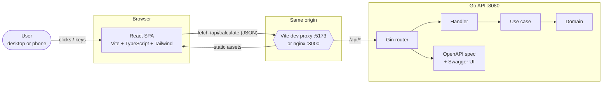
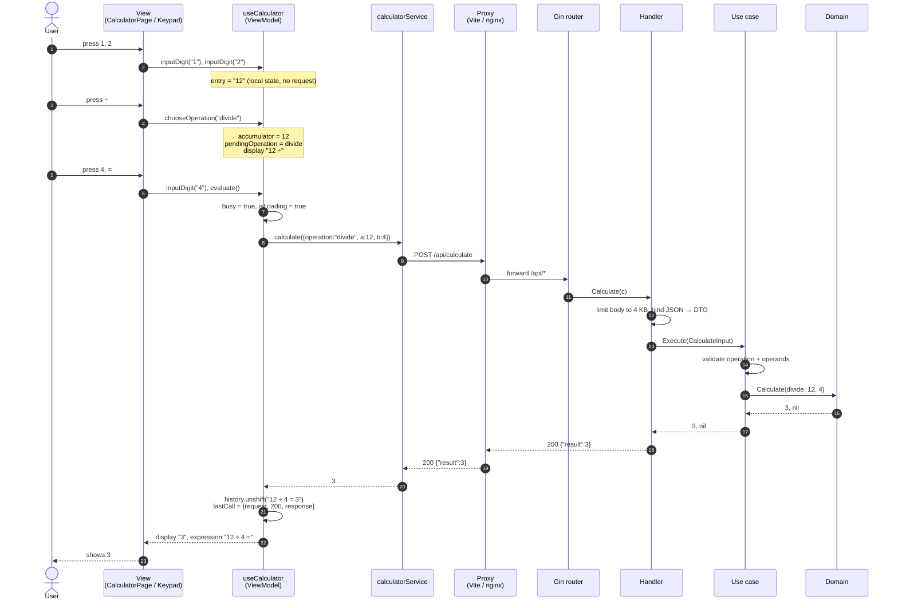
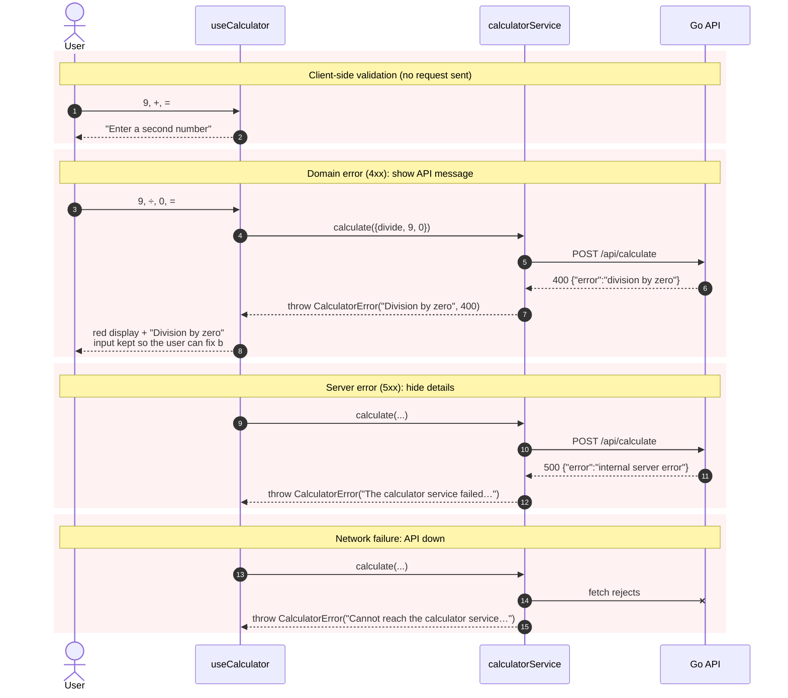
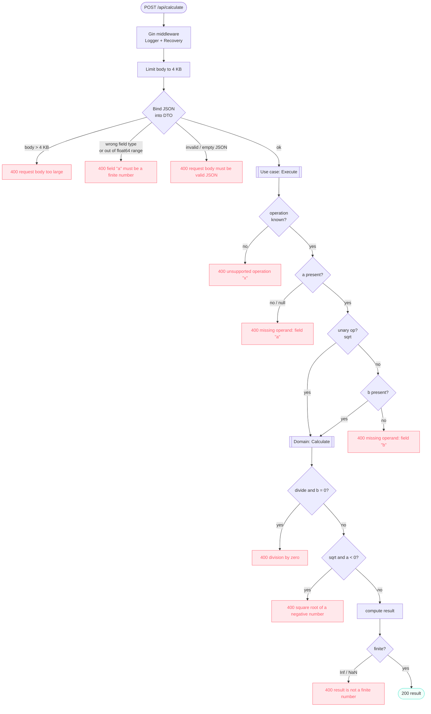
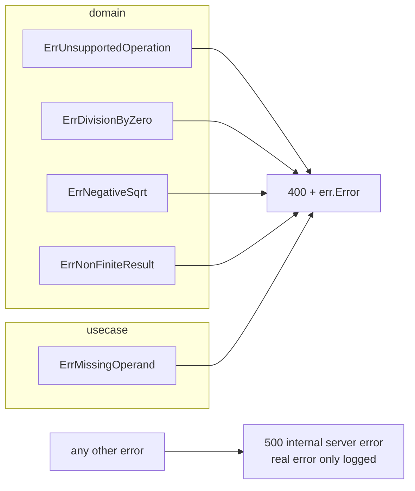
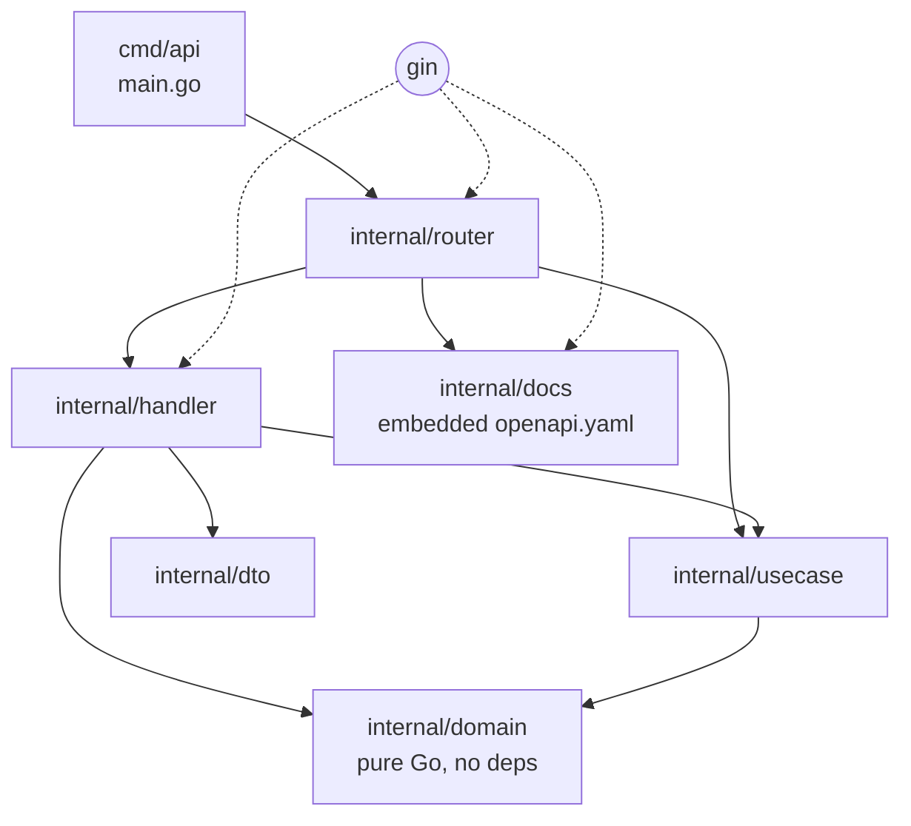
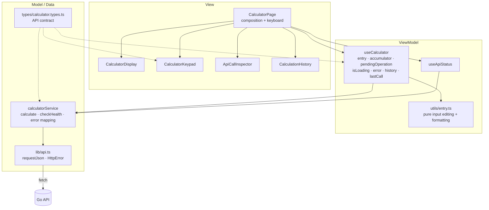
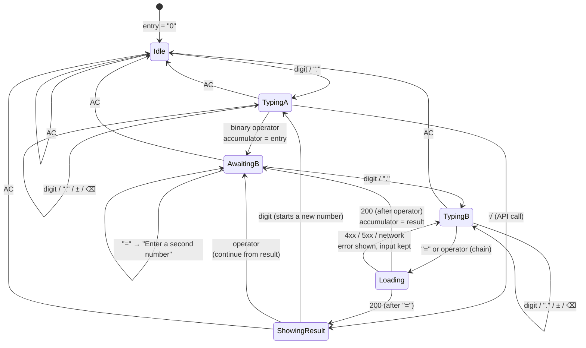
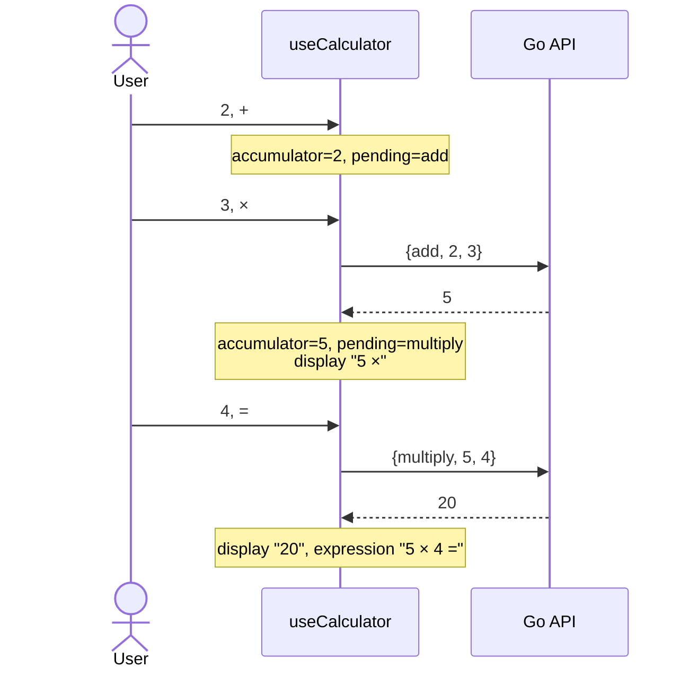
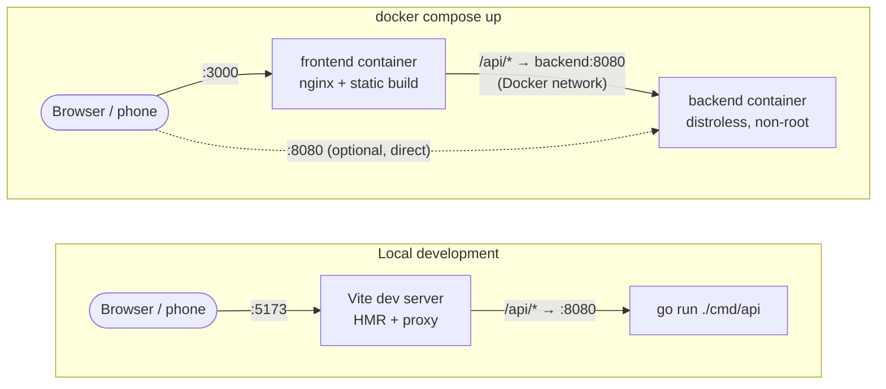

# Architecture

Detailed diagrams of how the calculator works. For setup and the API reference, see the [README](../README.md). The live OpenAPI docs are served at `/api/docs`.

- [1. System overview](#1-system-overview)
- [2. Request lifecycle: successful calculation](#2-request-lifecycle-successful-calculation)
- [3. Request lifecycle: error paths](#3-request-lifecycle-error-paths)
- [4. Backend steps inside `POST /api/calculate`](#4-backend-steps-inside-post-apicalculate)
- [5. Backend package dependencies](#5-backend-package-dependencies)
- [6. Frontend layers (MVVM-inspired)](#6-frontend-layers-mvvm-inspired)
- [7. Keypad state machine](#7-keypad-state-machine)
- [8. Chained operations](#8-chained-operations)
- [9. Deployment topologies](#9-deployment-topologies)

---

## 1. System overview

The browser only ever talks to **its own origin**. A proxy (Vite in development, nginx in Docker) forwards `/api/*` to the Go service. As a result, there is no CORS setup, and the browser never needs to resolve Docker hostnames.

## 2. Request lifecycle: successful calculation

What happens when the user presses `1` `2` `÷` `4` `=`. The digit and operator keys only change local state. **Only `=` makes a network call.**

## 3. Request lifecycle: error paths

Each layer handles the errors it knows about. The **service** turns transport failures into messages the user can read. The **handler** turns domain and use-case errors into HTTP statuses.

## 4. Backend steps inside `POST /api/calculate`

Every exit from this flowchart is a JSON response.

The handler maps errors with `errors.Is`, so the use case and domain stay independent of HTTP:

## 5. Backend package dependencies

Dependencies point inward. `domain` imports nothing from the project, and only `handler` and `router` know about Gin.

| Layer | Knows HTTP? | Knows JSON? | Tested with |
| --- | --- | --- | --- |
| `domain` | no | no | table-driven unit tests |
| `usecase` | no | no | unit tests |
| `handler` | yes | yes | `httptest` + fake use case |
| `router` (full stack) | yes | yes | `httptest` integration tests in `tests/` |
| `docs` | – | – | contract test: spec enum = `domain.Operations` |

## 6. Frontend layers (MVVM-inspired)

## 7. Keypad state machine

This is the local state managed by `useCalculator`. Network calls happen only on the `chooseOperation` (chained or unary) and `evaluate` transitions.

Keys pressed during **Loading** are not dropped. They are queued and replayed in order once the response arrives, so typing `2+3*4⏎` at full speed still gives `20`. This is covered by an E2E test and a unit regression test.

## 8. Chained operations

The calculator evaluates **left to right as you type**, like a pocket calculator, and always delegates the math to the API.

## 9. Deployment topologies

Both setups listen on `0.0.0.0`, so a phone on the same Wi-Fi can open `http://<mac-ip>:5173` or `http://<mac-ip>:3000`.
