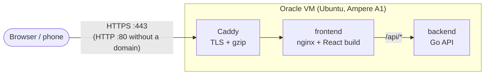

# Deploying to Oracle Cloud (Always Free)

This guide runs the whole stack on **one Always Free VM** with Docker Compose, with Caddy in front for HTTPS. It costs nothing as long as you stay within the Always Free limits.



Only Caddy is exposed. The frontend and backend are reachable only on the internal Docker network (see [`deploy/oracle/compose.prod.yaml`](../deploy/oracle/compose.prod.yaml)).

## 0. Before you start

- The code must be **pushed** to a Git host, with the release merged into **`main`**, because the script deploys `main` by default. To deploy a different branch, set `BRANCH=develop`.
- A **public** repository is the simplest option. For a private one, add an SSH deploy key on the VM and use the `git@…` URL.

## 1. Create the account

1. Sign up at <https://signup.cloud.oracle.com>. A credit card is required for identity verification. Always Free resources are not charged.
2. **Choose the home region carefully.** It is permanent, and Always Free compute only runs there. From Brazil, *Brazil East (São Paulo)* or *Brazil Southeast (Vinhedo)* gives the lowest latency.

## 2. Create the VM

**Compute → Instances → Create instance**

| Setting | Value |
| --- | --- |
| Image | **Canonical Ubuntu 24.04** |
| Shape | **Ampere → VM.Standard.A1.Flex**, 2 OCPU / 12 GB (Always Free allows up to 4 OCPU / 24 GB in total) |
| Networking | default VCN, public subnet, **Assign a public IPv4 address** ✅ |
| SSH keys | *Generate a key pair* and **download the private key**, or paste your own public key |

> **"Out of capacity for shape VM.Standard.A1.Flex"** is common. Try another availability domain, try 1 OCPU / 6 GB, or try again later. Upgrading the account to *Pay As You Go* usually solves it, and you are still not charged while you stay within Always Free limits. It also stops Oracle from reclaiming idle free instances.

Copy the instance's **public IP** when it is running.

## 3. Open ports 80 and 443 in the VCN

Oracle blocks traffic in **two places**. This is the first one, in the cloud network.

**Instance → Subnet → Default Security List → Add Ingress Rules**

| Source CIDR | IP protocol | Destination port |
| --- | --- | --- |
| `0.0.0.0/0` | TCP | `80` |
| `0.0.0.0/0` | TCP | `443` |
| `0.0.0.0/0` | UDP | `443` (optional, HTTP/3) |

The second place is the VM's own `iptables`. The setup script opens it for you.

## 4. Deploy

```bash
chmod 400 ~/Downloads/ssh-key-*.key
ssh -i ~/Downloads/ssh-key-*.key ubuntu@<public-ip>

# on the VM:
git clone <repo-url> ~/calculator
~/calculator/deploy/oracle/setup.sh <repo-url>
```

[`setup.sh`](../deploy/oracle/setup.sh) does the following:
1. installs Docker
2. opens 80/443 in `iptables` and saves the rules
3. clones or updates the repo
4. builds the images on the VM (ARM is fine: every base image is multi-arch)
5. starts the stack with `restart: always`, so it survives reboots
6. waits for `/api/health` and prints the URL

The first build takes a few minutes. Open `http://<public-ip>`, with Swagger at `http://<public-ip>/api/docs`.

## 5. HTTPS with a free domain (optional, recommended)

Let's Encrypt needs a domain name, not a bare IP.

1. Get a free subdomain at <https://www.duckdns.org>, for example `my-calculator.duckdns.org`, and point it to the VM's public IP.
2. Re-run the script with the domain:
   ```bash
   ~/calculator/deploy/oracle/setup.sh <repo-url> my-calculator.duckdns.org
   ```
   Caddy obtains and renews the certificate automatically and redirects HTTP to HTTPS. Certificates are kept in the `caddy_data` volume.

## Operating it

| Task | Command (in `~/calculator`) |
| --- | --- |
| Deploy a new version | `./deploy/oracle/setup.sh <repo-url> [domain]` (pulls and rebuilds) |
| Status | `sudo docker compose -f compose.yaml -f deploy/oracle/compose.prod.yaml ps` |
| Logs | `sudo docker compose -f compose.yaml -f deploy/oracle/compose.prod.yaml logs -f` |
| Stop | `sudo docker compose -f compose.yaml -f deploy/oracle/compose.prod.yaml down` |

## Tuning the rate limit

The API allows 20 requests per minute per client IP by default. To change it, add the values to `~/calculator/.env` (next to `SITE_ADDRESS`) and re-run `setup.sh`:

```bash
RATE_LIMIT_REQUESTS=10
RATE_LIMIT_WINDOW=1m
```

The real client IP is preserved through Caddy → nginx → Go, so each visitor gets their own budget. Spoofed `X-Forwarded-For` headers are discarded by Caddy. For protection against volumetric DDoS, put Cloudflare (free plan) or OCI WAF in front of the VM.

## Troubleshooting

| Symptom | Likely cause |
| --- | --- |
| Browser times out, but `curl localhost` on the VM works | VCN Security List is missing the 80/443 ingress rules (step 3) |
| Times out from outside and the rules exist | the `iptables` rules were not applied; re-run `setup.sh`, then check with `sudo iptables -L INPUT -n` |
| Caddy logs show certificate errors | the domain does not resolve to the VM yet, or port 80 is not reachable (Let's Encrypt validates over HTTP) |
| Page loads, but "API offline" | backend container down; check `logs backend` |
| Instance stopped by itself after some idle days | Always Free idle reclamation; upgrade to Pay As You Go (still free within limits) |

> Free-tier rules and limits change over time. Check Oracle's current Always Free documentation if something above no longer matches.
